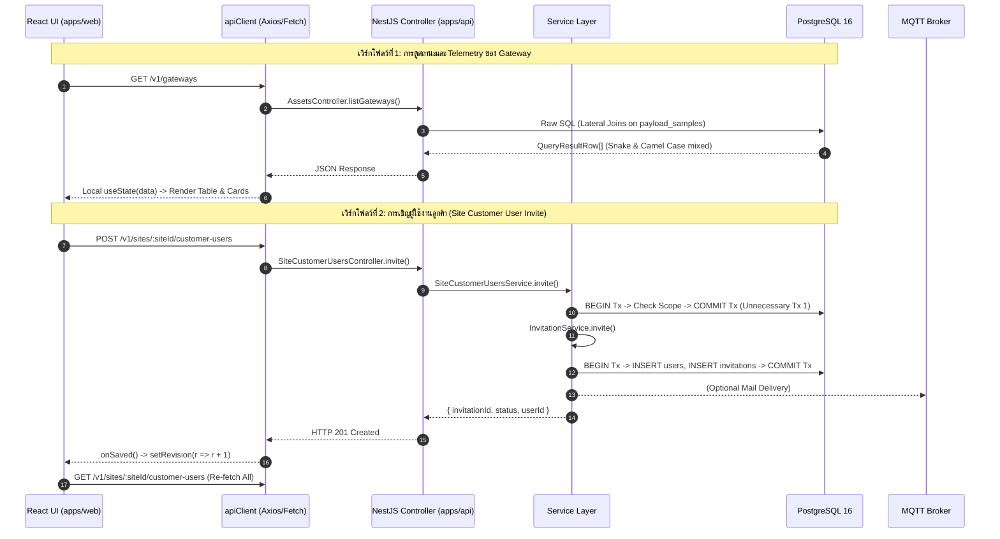

# รายงานการตรวจสอบโครงสร้างโค้ดและการปรับปรุงระบบ (Codebase Audit & Refactoring Plan)
## เอกสารฉบับที่ 05: การไหลของข้อมูลและการจัดการสถานะ (Data Flow & State Management)

**วันที่ตรวจสอบ:** 16 ตุลาคม 2026  
**ขอบเขต:** การติดตามเส้นทางการไหลของข้อมูลแบบ End-to-End (Database → API → Frontend State → UI), การประเมินขอบเขตของ Transaction ใน Backend, และรูปแบบการจัดการสถานะใน Frontend

---

### 1. การติดตามเส้นทางการไหลของข้อมูลแบบ End-to-End (End-to-End Data Tracing)

ในการทำความเข้าใจการเชื่อมโยงของระบบ ได้ทำการ Trace เส้นทางการไหลของข้อมูลใน 3 เวิร์กโฟลว์หลัก:



---

### 2. ปัญหาและรูปแบบที่ไม่พึงประสงค์ในการจัดการสถานะฝั่ง Frontend (State Management Anti-Patterns)

#### 2.1 วงจรความซ้ำซ้อนของ `useEffect` และตัวนับ `revision` (The "Revision Cascade")
ทั่วทั้ง `apps/web` มีการใช้งานตัวแปร `const [revision, setRevision] = useState(0)` มากถึง 176 ครั้ง เพื่อสั่งให้ `useEffect` ดึงข้อมูลใหม่เมื่อมีการเปลี่ยนแปลง:

```typescript
// ตัวอย่างที่พบใน apps/web/features/sites/site-customer-users.tsx
const [users, setUsers] = useState<CustomerUser[]>([]);
const [loading, setLoading] = useState(true);
const [revision, setRevision] = useState(0);

useEffect(() => {
  let active = true;
  setLoading(true);
  apiClient
    .get(`/v1/sites/${encodeURIComponent(siteId)}/customer-users`)
    .then((res) => { if (active) setUsers(res.users); })
    .catch((err) => { if (active) setError(err.message); })
    .finally(() => { if (active) setLoading(false); });

  return () => { active = false; };
}, [siteId, revision]); // Triggered by setRevision(r => r + 1)
```

**ข้อเสียของรูปแบบนี้:**
1. **ขาดแคชระดับ Client-side (No Caching):** เมื่อผู้ใช้คลิกสลับแท็บไปมาระหว่างหน้า "ภาพรวม", "ข้อมูลลูกค้า", หรือ "การตั้งค่า" ข้อมูลเดิมจะถูกทิ้งและต้องยิง HTTP Request ซ้ำทุกครั้ง ทำให้เกิดอาการกะพริบ (Flickering) และสิ้นเปลือง Network Bandwidth
2. **Prop Drilling of Mutators:** คอมโพเนนต์แม่ต้องส่งฟังก์ชัน `onSaved={() => setRevision(r => r + 1)}` ทะลุผ่านหลายชั้นของคอมโพเนนต์ลูก
3. **การ Re-fetch ยกชุด (Over-fetching on Invalidation):** แม้จะแก้ไขเพียงชื่อผู้ใช้คนเดียว แต่ระบบจะดึงข้อมูลผู้ใช้ทั้งหมด 500 แถวกลับมาใหม่ทั้งหมด

#### 2.2 โอกาสในการใช้ `@tanstack/react-query` ที่ติดตั้งไว้แล้ว
การติดตั้ง `@tanstack/react-query: ^5.102.8` ไว้ใน `package.json` ถือเป็นข้อได้เปรียบ สามารถเปลี่ยนมาใช้แพทเทิร์นมาตรฐานได้ทันที:
```typescript
// แนวทางที่ควรจะเป็น:
export function useSiteCustomerUsers(siteId: string) {
  return useQuery({
    queryKey: ['sites', siteId, 'customer-users'],
    queryFn: () => apiClient.get(`/v1/sites/${encodeURIComponent(siteId)}/customer-users`),
    staleTime: 30_000, // แคชไว้ 30 วินาที ไม่ต้องยิงซ้ำหากสลับแท็บ
  });
}

// ใน Modal หลังบันทึกเสร็จ:
const queryClient = useQueryClient();
await queryClient.invalidateQueries({ queryKey: ['sites', siteId, 'customer-users'] });
```
รูปแบบนี้จะกำจัด `useEffect`, `active flag`, `loading state`, `error state`, และ `revision state` ออกไปทั้งหมดโดยอัตโนมัติ

---

### 3. ขอบเขตของ Database Transaction ใน Backend (Transaction Boundaries)

จากการตรวจสอบคำสั่ง Transaction ใน `apps/api` พบทั้งปัญหา **Transaction ละเมิดคำสั่งอ่าน** และ **Transaction ตกหล่นในคำสั่งเขียน**:

| ประเภทปัญหา | บริบทโค้ด (Context) | ปัญหาที่ตรวจพบ | ผลกระทบและข้อเสนอแนะ |
| :--- | :--- | :--- | :--- |
| **Transaction Abuse (คำสั่งอ่าน)** | `site-customer-users.service.ts:31, 50`<br>`invitation.service.ts:178` | เปิด Transaction ครอบคำสั่ง `SELECT` ธรรมดา | ผูกขาด Connection จาก Pool ขนาด 12 ตัวโดยใช่เหตุ ควรถอด `this.db.transaction()` ออกและใช้ `this.db.query()` |
| **Transaction Fragmentation (แยก Tx ซ้ำซ้อน)** | `site-customer-users.service.ts:50` (`invite`) | เปิด Transaction ที่ 1 เพื่อเช็คสิทธิ์ไซต์งาน (`scope`) แล้วปิด จากนั้นเรียก `invitations.invite()` ซึ่งเปิด Transaction ที่ 2 | ไม่เป็น Atomic เดียวกัน หากขั้นที่ 2 ล้มเหลว ข้อมูลขั้นที่ 1 อาจเกิดความไม่สอดคล้อง ควรครอบด้วย Transaction เดียวตั้งแต่ต้นจนจบ |
| **Missing Transaction (คำสั่งเขียนหลายขั้นตอน)** | `assets.controller.ts:740-840` (`updateSite`) | มีการรันคำสั่ง SQL แก้ไขตาราง `sites`, ตามด้วย `gateways`, ตามด้วย `devices` โดยไม่ได้ครอบด้วย `BEGIN ... COMMIT` | หากการบันทึก Gateway เกิดล้มเหลว (เช่น เจอ SQL Bug ที่บรรทัด 783) ข้อมูลในตาราง `sites` จะถูกแก้ไขไปแล้ว แต่ตาราง `gateways` ไม่เปลี่ยน ทำให้ฐานข้อมูลเกิดสถานะครึ่งๆ กลางๆ (Inconsistent State) |

---

### 4. ความสอดคล้องของ API Contracts (Contract Consistency)

1. **การแปลงชื่อฟิลด์ระหว่าง Database (snake_case) และ API (camelCase):**
   - ใน `assets.controller.ts`: อาศัยการเขียน SQL Alias ด้วยตนเองในทุก Query เช่น:
     `SELECT s.id, s.name, s.external_site_id AS "siteCode", g.last_seen_at AS "lastSeenAt" ...`
   - หากโปรแกรมเมอร์ลืมใส่ Alias ในฟิลด์ใดฟิลด์หนึ่ง ฝั่ง Frontend จะได้รับ `external_site_id` แทนที่จะเป็น `externalSiteId` ซึ่งทำให้หน้าเว็บแสดงค่า `undefined`
2. **การแชร์ DTO ผ่าน `packages/api-contracts`:**
   - ควรรวมศูนย์ Response Mapper ของไซต์งานและเกตเวย์ไว้ใน Service และคืนค่าตาม Interface ใน `packages/api-contracts` เพื่อให้ TypeScript Compiler สามารถตรวจจับความไม่ตรงกันของสัญญาข้อมูลได้ตั้งแต่ตอน Build
