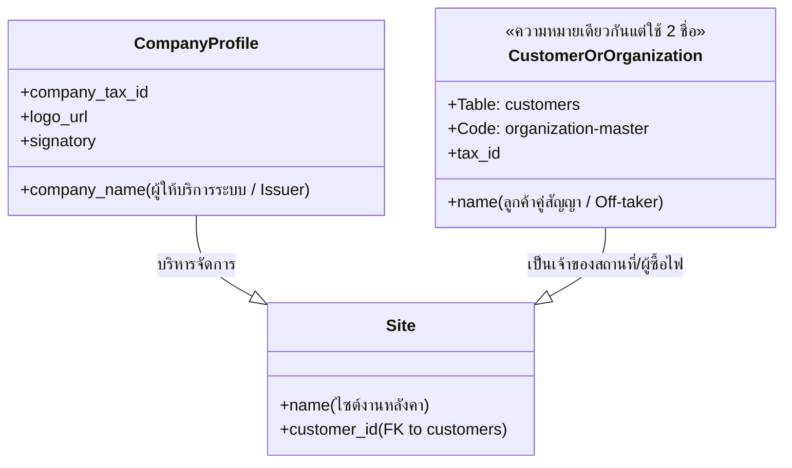

# รายงานการตรวจสอบโครงสร้างโค้ดและการปรับปรุงระบบ (Codebase Audit & Refactoring Plan)
## เอกสารฉบับที่ 07: การตรวจสอบความสอดคล้องของการตั้งชื่อและแบบจำลองโดเมน (Naming & Domain Consistency)

**วันที่ตรวจสอบ:** 16 ตุลาคม 2026  
**ขอบเขต:** ความสอดคล้องของคำศัพท์ทางโดเมน (Domain Terminology), การตั้งชื่อตัวแปรและฟังก์ชัน (Variables & Functions), และแบบแผนการตั้งชื่อไฟล์และคอมโพเนนต์ (File & Component Naming)

---

### 1. ความขัดแย้งของคำศัพท์ทางโดเมน (Domain Model Inconsistencies)

จากการสำรวจความหมายของข้อมูลที่ใช้ในฐานข้อมูล, โค้ด Backend, และหน้าจอ Frontend พบความสับสนระหว่างคำศัพท์ 3 คำหลัก ได้แก่ **Customer**, **Organization**, และ **Company**:

| คำศัพท์ที่ปรากฏ (Term) | ตำแหน่งที่พบในโค้ด (Occurrences) | ความหมายที่แท้จริงในบริบทระบบ (Actual Domain Meaning) | ปัญหาที่ตรวจพบ (Identified Issue) |
| :--- | :--- | :--- | :--- |
| **`Customer`** | - ตารางในฐานข้อมูล: `customers`<br>- ฟิลด์: `customer_id`<br>- สิทธิ: `customer_user`<br>- คลาส: `CustomerRecord` | นิติบุคคลหรือผู้ว่าจ้างที่ติดตั้งระบบ Solar Roof บนหลังคาและเป็นผู้รับบิลค่าไฟ (PPA Client / Off-taker) | มีการสลับไปเรียกว่า `Organization` ในโมดูลจัดการข้อมูลหลัก |
| **`Organization`** | - ไฟล์: `organization-master.ts`<br>- ไฟล์: `organization-defaults.ts`<br>- ไทป์: `OrganizationInput`<br>- ฟังก์ชัน: `resolveSiteOrganization` | นิติบุคคลคู่สัญญาของไซต์งาน (ซึ่งก็คือ `Customer` นั่นเอง) | ใช้ชื่อ `Organization` ในโค้ด แต่บันทึกลงตารางชื่อ `customers` ทำให้เกิดความสับสนว่าระบบมี Organization แยกต่างหากจาก Customer หรือไม่ |
| **`Company`** | - ตารางในฐานข้อมูล: `company_profile`<br>- โมดูล: `company-image.ts`<br>- ฟิลด์: `company_name`, `company_tax_id`<br>- หน้าจอ: การตั้งค่าบริษัท | นิติบุคคลผู้ให้บริการ/ผู้ลงทุนโครงการ Solar Roof (Platform Owner / Energy Issuer) | ในบางหน้าจอมีการใช้คำว่า "องค์กร" ปะปนกับ "บริษัทผู้ดูแล" ทำให้ผู้ใช้งานสับสนระหว่างบริษัทตนเองกับบริษัทลูกค้า |



#### ข้อเสนอแนะในการปรับปรุงแบบจำลองโดเมน (Domain Model Alignment):
1. **จัดทำนิยามมาตรฐาน (Standard Glossary):**
   - **Company (บริษัท):** สงวนไว้สำหรับนิติบุคคลผู้ให้บริการแพลตฟอร์ม (Platform Owner) เช่น บันทึกใน `company_profile`
   - **Customer (ลูกค้า/ผู้ซื้อพลังงาน):** ให้ใช้คำว่า `Customer` อย่างสม่ำเสมอในทุกเลเยอร์ ยกเลิกการเรียกสลับเป็น `Organization` เพื่อลดความสับสน
2. **Refactor ชื่อฟังก์ชันใน Backend:**
   - เปลี่ยนชื่อ `organization-master.ts` ให้สอดคล้องกับตารางฐานข้อมูล เช่น `customer-master.ts` หรือกำหนด Alias ให้ชัดเจน

---

### 2. ความไม่สอดคล้องของการตั้งชื่อตัวแปรและฟังก์ชัน (Variable & Function Inconsistencies)

#### 2.1 การแสดงสถานะ Boolean (Boolean Flag Inconsistencies)
พบการใช้หลากหลายรูปแบบเพื่อสื่อถึงสถานะ เปิด/ปิด หรือ ใช้งาน/ระงับ:
- ใน `apps/api/src/modules/assets/assets.service.ts`:
  - `CustomerRecord`: ใช้ `status: 'active' | 'inactive'`
  - `SiteRecord`: ใช้ `status: 'active' | 'inactive'`
  - `BillingMeterRecord`: ใช้ `active: boolean` (เป็น boolean แทน enum status)
- ใน `apps/api/src/modules/notifications/operational-automation.service.ts`:
  - ใช้ `enabled: boolean` ใน Rule Schema
  - ใช้ `recovery: boolean`
- ใน `apps/api/src/modules/assets/assets.controller.ts:64`:
  - ส่งกลับค่า `true AS active` ใน Query

**ข้อเสนอแนะ:** ควรกำหนดมาตรฐานว่าสำหรับ Entity Record หลักให้ใช้ `status: 'active' | 'inactive' | 'archived'` เพื่อรองรับ Soft-delete ในอนาคต และสำหรับ Feature Toggle หรือ Rule Configuration ให้ใช้คำนำหน้า `is` หรือ `has` เช่น `isEnabled: boolean`

#### 2.2 ตัวแปรย่อที่สั้นเกินไปและยากต่อการอ่าน (Cryptic Loop Variables & Abbreviations)
ใน `apps/api/src/modules/assets/assets.controller.ts:777-800`:
```typescript
const gwUpdates: string[] = [];
const gwValues: unknown[] = [];
let gIdx = 1;

if(body.mqttBrokerId !== undefined){
  // ...
  gwUpdates.push(`mqtt_broker_id = ${gIdx++}`); // นอกจากชื่อย่อ gIdx ยังทำให้เกิด Bug ตกเครื่องหมาย $
}
```
- การใช้ตัวแปรชื่อ `gwUpdates`, `gwValues`, `gIdx` ในฟังก์ชันที่มีความยาวหลายร้อยบรรทัด เพิ่มความเสี่ยงในการคำนวณดัชนีพลาด
- ควรเปลี่ยนเป็น `gatewayUpdateClauses`, `gatewayQueryValues`, `parameterIndex` เพื่อให้อ่านเข้าใจได้ทันที

---

### 3. แบบแผนการตั้งชื่อไฟล์และคอมโพเนนต์ (File & Component Naming Conventions)

#### 3.1 ความสับสนระหว่าง Modal, Dialog, และ Sheet
ใน `apps/web/features/` พบการตั้งชื่อประเภทของหน้าต่างลอยที่ไม่สอดคล้องกัน:
- `site-form-dialog.tsx` (ใช้ไวยากรณ์ `Dialog` ของ Radix UI)
- `billing-detail-modal.tsx` (ใช้ไวยากรณ์ `Dialog` แต่ตั้งชื่อไฟล์ว่า `modal`)
- `billing-detail-sheet.tsx` (ใช้ไวยากรณ์ `Sheet` แต่เป็นโค้ดร้าง)
- `confirm-action.tsx` (ใช้ไวยากรณ์ `AlertDialog` แต่ไม่มีคำว่า Dialog หรือ Modal ในชื่อไฟล์)

**ข้อเสนอแนะในการปรับชื่อให้สอดคล้องกัน:**
- หน้าต่างที่แสดงผลตรงกลางจอและมี Backdrop ให้ใช้คำลงท้าย **`-dialog.tsx`** ทั้งหมด (ตามการตั้งชื่อของ Radix UI Primitives)
- หน้าต่างที่เลื่อนออกมาจากขอบข้าง (Slide-over panel) ให้ใช้คำลงท้าย **`-sheet.tsx`**
- หน้าต่างแจ้งเตือนหรือยืนยันคำสั่งให้ใช้คำลงท้าย **`-confirm-dialog.tsx`**
