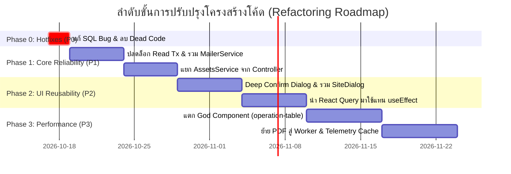

# รายงานการตรวจสอบโครงสร้างโค้ดและการปรับปรุงระบบ (Codebase Audit & Refactoring Plan)
## เอกสารฉบับที่ 08: แผนงานการปรับปรุงเชิงลำดับขั้น (Refactoring & Optimization Roadmap)

**วันที่ตรวจสอบ:** 16 ตุลาคม 2026  
**ขอบเขต:** แผนการดำเนินงานปรับปรุงโค้ดเบสแบบเป็นขั้นตอน (Phased Implementation Plan) ตั้งแต่ P0 (ด่วนที่สุด) ถึง P3 (การเพิ่มประสิทธิภาพระยะยาว) พร้อมเกณฑ์การยอมรับ (Acceptance Criteria), การประเมินความเสี่ยง, และแผนสำรอง (Rollback Strategy)

---

### 1. สรุปภาพรวมแผนงานปรับปรุง 4 ระยะ (Roadmap Overview)



---

### 2. รายละเอียดแผนงานในแต่ละระยะ (Phased Tasks & Action Items)

---

#### 🔴 Phase 0: Immediate Hotfixes & Dead Code Removal (P0 — แก้ไขทันทีใน 1-2 วัน)
*เป้าหมาย: แก้ไขบั๊กที่ส่งผลต่อความถูกต้องของข้อมูลในทันที และกำจัดโค้ดร้างที่สร้างภาระ โดยไม่มีความเสี่ยงต่อการกระทบ API ภายนอก*

##### Task 0.1: แก้ไข SQL Parameter Indexing Bug ใน Assets Controller
- **ตำแหน่ง:** `apps/api/src/modules/assets/assets.controller.ts:783`
- **การดำเนินการ:** เติมเครื่องหมาย `$` หน้าสตริงเทมเพลต:
  ```diff
  - gwUpdates.push(`mqtt_broker_id = ${gIdx++}`);
  + gwUpdates.push(`mqtt_broker_id = $${gIdx++}`);
  ```
- **Acceptance Criteria (AC):** การอัปเดต `mqttBrokerId` ผ่าน `PATCH /v1/sites/:siteId` บันทึกลงฐานข้อมูลได้สำเร็จโดยไม่เกิด PostgreSQL Type Mismatch Error
- **Verification:** รัน `pnpm --filter @solar/api test`

##### Task 0.2: ลบไฟล์โค้ดร้าง Billing Detail Sheet
- **ตำแหน่ง:** `apps/web/features/billing/billing-detail-sheet.tsx`
- **การดำเนินการ:** ลบไฟล์ทิ้ง (ลดขนาดโค้ดทันที 562 บรรทัด)
- **Acceptance Criteria (AC):** `pnpm --filter @solar/web build` สำเร็จ 100% โดยไม่มีข้อผิดพลาด Missing Import
- **Verification:** รัน `pnpm --filter @solar/web build`

##### Task 0.3: ลบ Unused Import ใน Billing Controller
- **ตำแหน่ง:** `apps/api/src/modules/billing/billing.controller.ts:28`
- **การดำเนินการ:** ลบ `import nodemailer from "nodemailer";` ออก
- **Acceptance Criteria (AC):** ไฟล์สะอาดขึ้นและไม่มี Linter Warning

##### Task 0.4: แก้ไข Configuration Fallback ของระบบส่งอีเมล
- **ตำแหน่ง:**
  - `apps/api/src/modules/billing/saved-document-delivery.ts:59` (เพิ่ม Fallback พอร์ต 587 ป้องกันค่า `NaN`)
  - `apps/api/src/modules/identity/invitation.service.ts:258` (เพิ่ม `process.env.SMTP_PASSWORD ?? process.env.SMTP_PASS`)
- **Acceptance Criteria (AC):** อีเมลส่งออกได้สำเร็จแม้จะไม่ได้ระบุ `SMTP_PORT` หรือใช้ชื่อ `SMTP_PASSWORD`

---

#### 🟠 Phase 1: High Priority Architecture & Reliability (P1 — สัปดาห์ที่ 1–2)
*เป้าหมาย: คืนความสมบูรณ์ให้แก่ Service Layer, คุ้มครอง Database Connection Pool, และสร้างความเสถียรของ Transaction*

##### Task 1.1: ปลดล็อกคำสั่งอ่านออกจาก Database Transaction
- **ตำแหน่ง:**
  - `apps/api/src/modules/identity/site-customer-users.service.ts:31, 50`
  - `apps/api/src/modules/identity/invitation.service.ts:178`
- **การดำเนินการ:** เปลี่ยนจากการเรียก `this.db.transaction()` ในฟังก์ชัน `list()`, `scope()`, และ `findOutstanding()` เป็นการเรียก `this.db.query()` โดยตรง
- **Acceptance Criteria (AC):**
  - ไม่มีการส่งคำสั่ง `BEGIN` และ `COMMIT` สำหรับการอ่านข้อมูล
  - ค่าเมตริก `db_pool_waiting` ลดลงอย่างเห็นได้ชัดเมื่อทดสอบจำลองโหลด (Load Test)

##### Task 1.2: รวมศูนย์ระบบส่งอีเมลด้วย `MailerService`
- **ตำแหน่งใหม่:** `apps/api/src/modules/mailer/mailer.service.ts`
- **การดำเนินการ:**
  - สร้าง NestJS Injectable Provider สำหรับจัดการ Nodemailer Transport ตัวเดียว
  - ทำการ Re-use Connection แทนการเปิด/ปิดใหม่ทุกครั้ง
  - Refactor ทั้ง 4 จุด (`identity-email`, `invitation.service`, `operational-automation`, `saved-document-delivery`) ให้หันมา Inject `MailerService`
- **Acceptance Criteria (AC):** มี Single Source of Truth สำหรับการตั้งค่า SMTP และทุกการส่งอีเมลผ่านตัวกลางเดียวกัน

##### Task 1.3: กู้ชีพ `AssetsService` และสกัด Raw SQL ออกจาก `AssetsController`
- **ตำแหน่ง:** `apps/api/src/modules/assets/assets.service.ts` และ `assets.controller.ts`
- **การดำเนินการ:**
  - ลบ In-memory Map Stub เดิมทิ้ง
  - ย้ายคำสั่ง SQL, การตรวจสอบสิทธิ์ขั้นสูง, และการควบคุม Transaction จาก `AssetsController` มาไว้ใน `AssetsService`
  - ลดขนาด `AssetsController` จาก 1,189 บรรทัด ให้เหลือต่ำกว่า 250 บรรทัด
- **Acceptance Criteria (AC):** `AssetsController` ทำหน้าที่เฉพาะการเป็น HTTP Dispatcher และสามารถเขียน Unit Test สำหรับ `AssetsService` ได้

---

#### 🟡 Phase 2: Component Reusability & Frontend De-duplication (P2 — สัปดาห์ที่ 3–4)
*เป้าหมาย: ขจัดโค้ดซ้ำซ้อนในฝั่ง UI, รวมศูนย์ Modal/Dialog, และปรับปรุงระบบการจัดการสถานะข้อมูลด้วย React Query*

##### Task 2.1: สร้าง `UnifiedConfirmDialog` (Deep Abstraction)
- **ตำแหน่ง:** `apps/web/components/feedback/confirm-action.tsx`
- **การดำเนินการ:** พัฒนาคอมโพเนนต์ให้รองรับ Controlled Open, Destructive Variant, Busy Spinner, และคำแปลสองภาษา (TH/EN)
- **Acceptance Criteria (AC):** นำไปใช้แทน `DiscardConfirmDialog`, `DeactivateConfirmDialog`, และ `CancelInviteConfirmDialog` ใน `site-customer-users.tsx` และ `staff-permissions-workspace.tsx` ได้โดยสมบูรณ์ (ลดโค้ดลงกว่า 450 บรรทัด)

##### Task 2.2: ควบรวม `SiteDialog` และ `GatewayDialog`
- **ตำแหน่ง:** `apps/web/features/sites/site-form-dialog.tsx` และ `site-edit-dialog.tsx`
- **การดำเนินการ:** ควบรวมเป็นคอมโพเนนต์เดียวที่รับ `mode: 'create' | 'edit'`
- **Acceptance Criteria (AC):** ลดไฟล์ที่ซ้ำซ้อนออก 1 คู่ (ลดโค้ดลงกว่า 700 บรรทัด) โดยฟังก์ชันการสร้างและแก้ไขไซต์งานยังคงทำงานถูกต้อง 100%

##### Task 2.3: นำ `@tanstack/react-query` มาใช้งานจริงใน Frontend
- **ตำแหน่ง:** `apps/web/providers/` และ `apps/web/features/`
- **การดำเนินการ:**
  - ติดตั้ง `QueryClientProvider` ที่ Root Layout
  - สร้าง Custom Hooks: `useSiteList`, `useGateways`, `useCustomerUsers`
  - ทยอยแทนที่แพทเทิร์น `useEffect` + `setRevision` เดิม
- **Acceptance Criteria (AC):** การสลับแท็บไม่เกิดการยิง Network Request ซ้ำ และกำจัดตัวแปร `revision` ออกจาก State

---

#### 🔵 Phase 3: Performance & God Component Decomposition (P3 — สัปดาห์ที่ 5–6)
*เป้าหมาย: เพิ่มความเร็วในการเรนเดอร์, ลดขนาด Bundle, และป้องกันการบล็อก Main Thread ใน Backend*

##### Task 3.1: แตกย่อย God Component `operation-table.tsx`
- **การดำเนินการ:**
  - สกัด Modal ย่อยทั้งหมดออกไปโหลดผ่าน `next/dynamic` (`{ ssr: false }`)
  - แยก Column Definition และ Action Handler ของแต่ละโดเมน (Billing, Invoice, Receipt, Telemetry) ออกจากกัน
- **Acceptance Criteria (AC):** Initial JS Bundle ของหน้า Dashboard ลดลงไม่น้อยกว่า 150KB

##### Task 3.2: ย้ายงานสร้าง PDF ขนาดใหญ่ไปไว้ใน Worker
- **ตำแหน่ง:** `apps/api/src/modules/documents/document-layout.ts`
- **การดำเนินการ:** ใช้ Background Worker (`apps/worker`) หรือ Node.js Worker Thread สำหรับการวาด `pdfkit`
- **Acceptance Criteria (AC):** API Main Event Loop ไม่ถูกบล็อกในระหว่างที่มีคำขอสร้างเอกสาร PDF

---

### 3. การประเมินความเสี่ยงและแผนการถอยกลับ (Risk Analysis & Rollback Strategy)

| งาน (Task) | ระดับความเสี่ยง | ความเสี่ยงที่อาจเกิดขึ้น (Potential Risk) | มาตรการป้องกันและแผนถอยกลับ (Mitigation & Rollback) |
| :--- | :---: | :--- | :--- |
| **P0: SQL Bug Fix** | ต่ำมาก 🟢 | การเปลี่ยน Parameter อาจกระทบลำดับตัวแปร | มีการทดสอบ Unit Test ยืนยัน Parameter Index ตรงจุด และทำ Git Atomic Commit เดี่ยวๆ |
| **P1: ปลดล็อก Read Tx** | ต่ำ 🟢 | อาจพบพฤติกรรม Non-repeatable read หากมีคำสั่งเขียนแทรก | คำสั่งเป็นแบบ Single Statement อยู่แล้ว จึงได้ผลลัพธ์ Atomic เสมอ หากมีปัญหาสามารถ Revert Commit ได้ทันที |
| **P1: MailerService** | ปานกลาง 🟡 | การเปลี่ยนจุดต่อ SMTP อาจทำให้เมลบางประเภทไม่ส่ง | ตั้งค่า Integration Test ทดสอบส่งทั้ง OTP, คำเชิญ, และบิลก่อนขึ้น Production |
| **P2: Unified Dialogs** | ต่ำ 🟢 | ปัญหาสไตล์การแสดงผล UI หรือข้อความหลุด | ตรวจสอบผ่าน Storybook หรือ Component Spec Test ก่อนนำไปแทนที่ในหน้างานจริง |
| **P3: Operation Table** | ปานกลาง 🟡 | Modal ปิด/เปิดไม่สัมพันธ์กับตาราง | แบ่งการทดสอบแยกตามแท็บเอกสารอย่างละเอียด (Regression Testing) |
